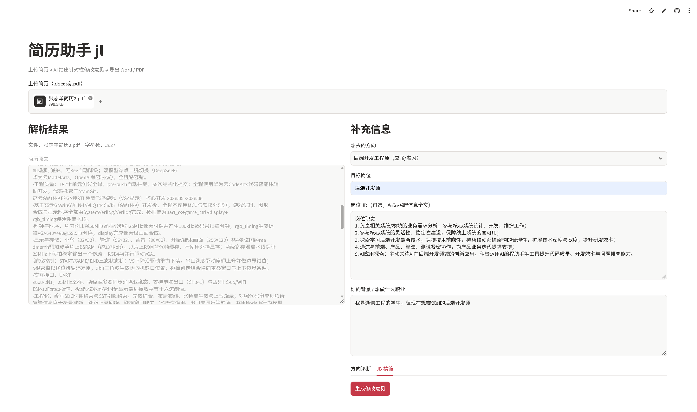
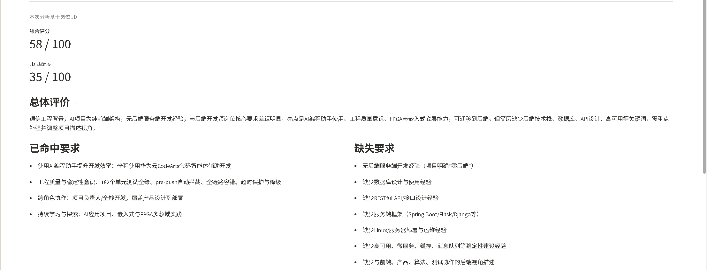
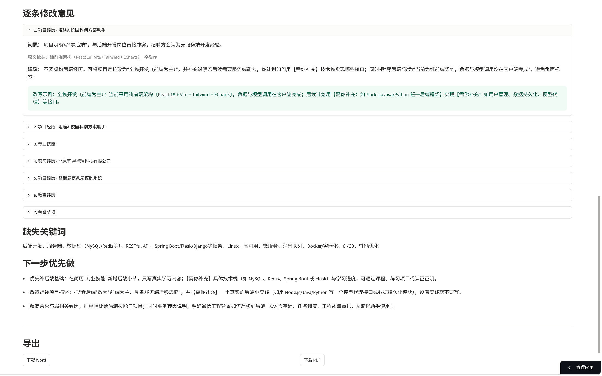
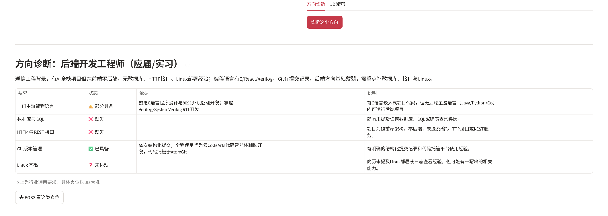

# 简历助手 (JL)

一句话：上传简历 + 贴岗位 JD → AI 给出可执行的修改建议，支持导出 Word/PDF。

🔗 在线体验：https://jl-resume.streamlit.app/
（首次打开需等 30 秒冷启动；站点设有访问口令，请向作者索取）



## 它解决什么问题

- **简历不知道改哪**：AI 逐条指出问题并给出可直接替换的改写示例，每条建议都标注「原文依据」，不会凭空编造。
- **JD 不知道对不对得上**：贴上完整招聘信息，返回匹配度评分、已命中与缺失的要求清单，而不是一句「还不错」。
- **换方向不知道差什么**：按五个行业的通用标准逐项评估能力缺口，告诉你先补哪一个、怎么补。

## 三个功能

### 1. 简历分析（贴 JD 时给出匹配度）





要点：

- 每条建议都带「原文依据」，逐字引自简历；找不到依据就不提这条
- 改写示例里凡是原文没有的内容，统一用【需你补充】标出，避免用户直接抄成造假

### 2. 方向诊断（按行业标准评估能力缺口）



- 四档状态：已具备 / 部分具备 / 缺失 / 未体现
- 「未体现」专门指简历没写但用户可能具备，与「缺失」严格区分
- 五个方向：后端 / 前端 / 嵌入式 / 测试 / AI 应用

### 3. 导出 Word / PDF

分析结果一键导出 Word 和 PDF，生成过程全部在内存完成，云端不落盘，也不保存任何上传文件。

## 设计上的三个取舍（面试会问）

1. **Key 只在服务端**：前端透明、后端保密，浏览器永远拿不到 Key。
2. **先 Streamlit 后前后端分离**：先验证链路能跑通，再考虑换实现。
3. **模型输出必须校验 + 重试**：模型返回结构不稳定，静默失败比崩溃更危险；两次仍不合格就明确报错，绝不渲染成「全部缺失」。

## 已知问题

- 免费层首次访问有 30 秒冷启动。
- 扫描件、文字转曲（设计软件导出）的 PDF 提取不到文字，会明确报错并提示原因，不会硬分析。
- 刷新页面会清空结果。
- 方向诊断偶尔需要点第二次（模型单次未必返回完整表格）。

## 本地运行

```bash
pip install -r requirements.txt
copy .env.example .env
streamlit run app/ui/streamlit_app.py
```

`.env` 里需要填两个变量：

- `DEEPSEEK_API_KEY`：模型 Key，在 DeepSeek 控制台申请
- `ACCESS_CODE`：访问口令，本地留空则跳过校验

## 技术栈

Python 3.12 / Streamlit / openai SDK（DeepSeek，OpenAI 兼容）/ python-docx / pdfplumber / reportlab / python-dotenv